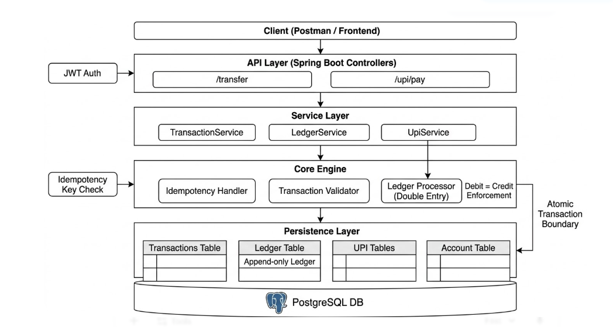
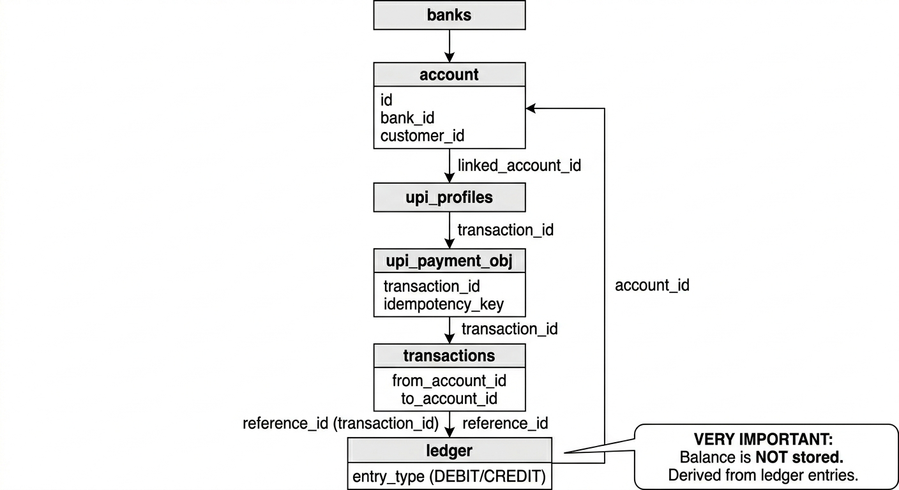
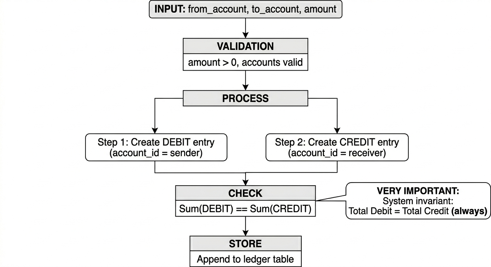
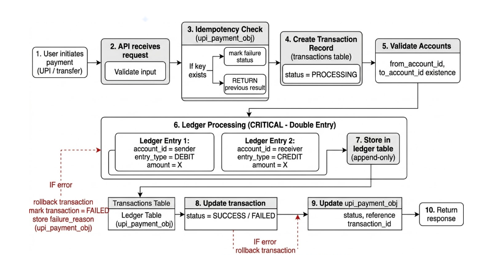
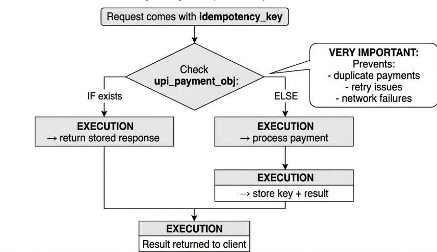

# 📊 BANK LEDGER & PAYMENT ENGINE — PROJECT REPORT 2026

**Initial Date:** February 9, 2026  
**Report Update:** November 12, 2026  
**Project Type:** Full-Stack Banking System — Spring Boot 3.5.10 REST API + React 18 Dashboard  
**Status:** Core banking workflows implemented; production readiness is not certified. See the latest validation and operational caveats below.

---

## 📌 TABLE OF CONTENTS

1. [Executive Summary](#-executive-summary)
2. [Technology Stack](#-technology-stack)
3. [System Architecture](#-system-architecture)
4. [Role-Based Access Control](#-role-based-access-control)
5. [Module 1 — Authentication & User Management](#module-1--authentication--user-management)
6. [Module 2 — Bank Management](#module-2--bank-management)
7. [Module 3 — Customer Management](#module-3--customer-management)
8. [Module 4 — Account Management](#module-4--account-management)
9. [Module 5 — Transaction Processing](#module-5--transaction-processing)
10. [Module 6 — Double-Entry Ledger Engine](#module-6--double-entry-ledger-engine)
11. [Module 7 — UPI Payment System](#module-7--upi-payment-system)
12. [Module 8 — QR Code Generation](#module-8--qr-code-generation)
13. [Module 9 — Audit Logging Pipeline](#module-9--audit-logging-pipeline)
14. [Module 10 — Security & Session Management](#module-10--security--session-management)
15. [Module 11 — Notifications](#module-11--notifications)
16. [Module 12 — Debit Card Management](#module-12--debit-card-management)
17. [Module 13 — Credit Card & Credit Plans](#module-13--credit-card--credit-plans)
18. [Module 14 — Loans & EMI](#module-14--loans--emi)
19. [Module 15 — Account Statement Export](#module-15--account-statement-export)
20. [Module 16 — Composite & Card Events APIs](#module-16--composite--card-events-apis)
21. [Frontend — React Dashboard](#frontend--react-dashboard)
22. [Operational Readiness](#-operational-readiness)
23. [Testing & QA](#-testing--qa)
24. [Observability & Monitoring](#-observability--monitoring)
25. [Security Design](#-security-design)
26. [Database Schema](#-database-schema)
27. [Recent Implementation Updates](#recent-implementation-updates)
28. [Business Rules & Constraints](#-business-rules--constraints)
29. [Bug Fixes & Improvements Applied](#-bug-fixes--improvements-applied)
30. [Performance Optimisations](#-performance-optimisations)
31. [Design Decisions & Tradeoffs](#-design-decisions--tradeoffs)
32. [Project Metrics](#-project-metrics)
33. [Future Enhancements](#-future-enhancements)
34. [Conclusion](#-conclusion)

---

## 🎯 EXECUTIVE SUMMARY

This is a full-stack banking application built with Spring Boot 3.5.10 and React 18. It implements a **double-entry financial ledger** as the source of truth for balances, provides **idempotent UPI payment processing**, and uses JWT authentication with five roles, refresh-token rotation, audit logging, session tracking, and an access-event security pipeline.

The React dashboard provides role-aware pages and dashboards, scoped banking data, account masking, transaction and payment visuals, QR code generation, compliance management, notifications, and audit/security screens.

### System Highlights

- ✅ **16 REST API modules** covering auth, banks, customers, accounts, transactions, UPI, QR, audit, security, notifications, debit cards, credit cards, loans, EMI, statements, and composite APIs
- ✅ **Generated OpenAPI 3.0.1 contract** documenting 117 path templates and 123 operations as of November 12, 2026
- ✅ **Role-based API authorization** combined with centralized ownership checks for reviewed user-scoped banking operations
- ✅ **20 JPA entities** across 13+ database tables, with complete relationship graph
- ✅ **Double-entry ledger** — every debit has a matching credit; balances derived from ledger, never stored
- ✅ **Idempotent UPI payments** — PROCESSING state persisted before execution; failure reason stored
- ✅ **Deadlock-free concurrent transactions** — deterministic pessimistic locking (ascending account ID order)
- ✅ **Full audit pipeline** — `AuditLoggingInterceptor` auto-captures every mutating HTTP request
- ✅ **Session management** — JWT sessions persisted as `UserSession` records, admin-terminable
- ✅ **Password recovery flow** — cryptographically random token, 15-minute TTL, single-use, delivered via email with a generic response
- ✅ **Refresh token rotation** — hashed refresh tokens persisted; reuse revokes all outstanding tokens for the user
- ✅ **Notification center** — per-user unread counts, mark-read operations, and transaction notifications
- ✅ **Async notification safety** — avoids relying on lazily loaded customer data after the originating transaction/session closes
- ✅ **Security exception handling** — authorization denials are mapped to forbidden responses rather than generic unexpected errors
- ✅ **Role-aware frontend** — customer/staff views use role-appropriate API data, display recipient names, and mask account identifiers
- ✅ **Real-data dashboard visuals** — profile metrics and transaction charts use backend data rather than placeholder values
- ✅ **QR code generation** — UPI payment QR (`upi://pay?...`) and account detail QR via ZXing
- ✅ **Enriched profile API** — `GET /api/auth/me` returns role-aware banking metrics and compliance counters
- ✅ **Debit card controls** — contactless, international, OTP toggles; daily/monthly limits; merchant category blocks; freeze/unfreeze/replace
- ✅ **Credit card & credit plans** — credit card issuance with linked plans and billing cycles
- ✅ **Loan & EMI management** — loan creation and EMI scheduling per account
- ✅ **Account statement export** — CSV and PDF export for any date range via `GET /api/accounts/{accountNumber}/statement`
- ✅ **Single-bank-per-customer constraint** — one user → one customer record → one bank, enforced at service layer and DB (partial unique index on `customers.user_id`)
- ✅ **YearMonthConverter** — JPA `AttributeConverter` for `YearMonth` (card expiry) mapped to `VARCHAR` `YYYY-MM`

---

## 📦 TECHNOLOGY STACK

### Backend

| Technology           | Version | Role                                                                           |
| -------------------- | ------- | ------------------------------------------------------------------------------ |
| Java                 | 21      | Language (records, pattern matching, virtual threads ready)                    |
| Spring Boot          | 3.5.10  | Core framework (web, JPA, validation, security, actuator)                      |
| Spring Security 6    | bundled | Stateless JWT auth + method-level `@PreAuthorize`                              |
| Spring Data JPA      | bundled | Repository layer with pessimistic locking                                      |
| Hibernate            | 6.6.x   | JPA provider, schema auto-generation                                           |
| PostgreSQL           | 15+     | Primary relational database (ACID)                                             |
| JJWT                 | 0.12.6  | JWT generation and validation (jjwt-api, jjwt-impl, jjwt-jackson)              |
| MapStruct            | 1.6.3   | Compile-time type-safe entity ↔ DTO mapping                                    |
| SpringDoc OpenAPI    | 2.7.0   | Swagger UI at `/api/swagger-ui/index.html`; OpenAPI JSON at `/api/v3/api-docs` |
| ZXing                | 3.5.3   | QR code generation (core + javase)                                             |
| Lombok               | bundled | Boilerplate elimination (@Getter, @Builder, @RequiredArgsConstructor)          |
| Jakarta Validation   | bundled | `@NotNull`, `@Valid`, `@Size` on request DTOs                                  |
| Spring Actuator      | bundled | Health/metrics endpoints (ADMIN-restricted)                                    |
| Spring Mail          | bundled | Password reset email delivery                                                  |
| Spring Cache + Redis | bundled | Optional caching for master data                                               |
| OpenPDF              | 1.3.30  | PDF statement generation                                                       |
| Maven                | 3.8+    | Build tool + Spotless formatter plugin                                         |

### Frontend

| Technology           | Version | Role                                   |
| -------------------- | ------- | -------------------------------------- |
| React                | 18      | UI framework                           |
| TypeScript           | 5.x     | Type-safe frontend code                |
| Vite                 | 5.x     | Dev server and build tool              |
| Tailwind CSS         | 3.x     | Utility-first styling                  |
| shadcn/ui + Radix UI | latest  | Accessible component library           |
| Recharts             | 2.x     | Charts (area, pie, bar)                |
| React Router         | v6      | Client-side routing + protected routes |
| Lucide React         | latest  | Icon set                               |
| React Query / fetch  | —       | API calls via `api-client.ts`          |

---

## 🏗️ SYSTEM ARCHITECTURE

### Layered Architecture

```
┌─────────────────────────────────────────────────────────┐
│  React 18 Frontend (bank-frontend/)                     │
│  TypeScript · Tailwind · shadcn/ui · Recharts           │
└────────────────────────┬────────────────────────────────┘
                         │  HTTP/REST  (CORS-gated)
┌────────────────────────▼────────────────────────────────┐
│  Spring Boot 3.5.10 Backend (port 8080)                 │
│                                                         │
│  ┌─── JWT Auth Filter ───────────────────────────────┐  │
│  │  JwtAuthenticationFilter  (stateless, per-request)│  │
│  └────────────────────────────────────────────────────┘  │
│                                                         │
│  ┌─── REST Controllers (19 controllers; 123 documented operations) ┐ │
│  │  /api/auth  /bank  /customer  /account              │ │
│  │  /transaction  /upi  /qr  /audit  /security         │ │
│  │  /api/notifications  /api/debit-cards  /api/credit-cards│ │
│  │  /api/loans  /api/accounts/{n}/statement  /api/composite│ │
│  └────────────────────────────────────────────────────┘ │
│                                                         │
│  ┌─── AuditLoggingInterceptor (auto-audit on every   ─┐ │
│  │    non-excluded POST/PUT/PATCH/DELETE request)      │ │
│  └────────────────────────────────────────────────────┘ │
│                                                         │
│  ┌─── Service Layer ─────────────────────────────────┐  │
│  │  AuthService  BankService  CustomerService         │  │
│  │  AccountsService  TransactionService  UpiService   │  │
│  │  AuditService  SecurityService                     │  │
│  └───────────────────────┬────────────────────────────┘  │
│                          │                              │
│  ┌───────────────────────▼────────────────────────────┐  │
│  │  Core Engine Primitives                            │  │
│  │  · LedgerWriter (double-entry posting)             │  │
│  │  · UpiResolver (ownership validation)              │  │
│  │  · lockAccountsInOrder() (deadlock prevention)     │  │
│  └───────────────────────┬────────────────────────────┘  │
│                          │                              │
│  ┌───────────────────────▼────────────────────────────┐  │
│  │  Repository Layer (20 JPA interfaces)              │  │
│  │  + Pessimistic write locks on Account              │  │
│  └───────────────────────┬────────────────────────────┘  │
└──────────────────────────┼──────────────────────────────┘
                           │
┌──────────────────────────▼──────────────────────────────┐
│  PostgreSQL 15+                                         │
│  20+ tables · 20+ indexes · ACID transactions           │
└─────────────────────────────────────────────────────────┘
```

### Design Patterns in Use

| Pattern                        | Where Applied                                                                                   |
| ------------------------------ | ----------------------------------------------------------------------------------------------- |
| Repository Pattern             | All 20 JPA repository interfaces                                                                |
| Service Layer Pattern          | Business logic in `*ServiceIMPL` classes                                                        |
| DTO Pattern                    | Separate Request/Response DTOs per domain                                                       |
| Mapper Pattern                 | MapStruct interfaces (compile-time)                                                             |
| Authorization Service          | `OwnershipAuthorizationService` — shared account/resource ownership checks                      |
| Value Object                   | `LockedAccounts` Java record — type-safe paired account locks                                   |
| Interceptor Pattern            | `AuditLoggingInterceptor` — cross-cutting audit concern                                         |
| Centralised Exception Handling | `GlobalExceptionHandler` with `@ControllerAdvice`                                               |
| Attribute Converter            | `YearMonthConverter` — JPA mapping of `YearMonth` ↔ `VARCHAR` for card expiry                   |
| Event-Driven                   | `TransactionStatusEvent` + `ApplicationEventPublisher` — transaction notifications after commit |

### Architecture Diagrams

> Diagram assets in `demo/docs/`







---

## 👥 ROLE-BASED ACCESS CONTROL

Five roles are defined in the `Role.RoleName` enum and enforced with method-level `@PreAuthorize` rules. Role checks are complemented by service-level ownership checks for user-scoped banking resources.

| Role                    | Key Permissions                                                                   |
| ----------------------- | --------------------------------------------------------------------------------- |
| `ROLE_ADMIN`            | All endpoints; delete operations; session management; actuator                    |
| `ROLE_MANAGER`          | Create/update banks, customers, accounts; view all financial data; UPI management |
| `ROLE_CUSTOMER_MANAGER` | Read/update customers and accounts; compliance updates; view transactions         |
| `ROLE_AUDITOR`          | Read-only access to all financial data; full access to audit logs                 |
| `ROLE_USER`             | Own accounts and transactions only; UPI registration and payment; QR generation   |

**Public endpoints** (no JWT required):

- `POST /api/auth/login`
- `POST /api/auth/forgot-password`
- `POST /api/auth/reset-password`
- `POST /api/auth/refresh`
- Swagger UI: `GET /api/swagger-ui/**`
- OpenAPI JSON: `GET /api/v3/api-docs/**`

---

## MODULE 1 — Authentication & User Management

**Base path:** `/api/auth`  
**Controller:** `AuthController`  
**Service:** `AuthService`  
**Entity:** `User`

### User Entity Fields

| Field                         | Type          | Notes                  |
| ----------------------------- | ------------- | ---------------------- |
| `id`                          | Long          | Auto-generated PK      |
| `username`                    | String        | Unique, not null       |
| `email`                       | String        | Unique, not null       |
| `password`                    | String        | BCrypt-encoded         |
| `fullName`                    | String        | Display name           |
| `phoneNumber`                 | String        | Contact                |
| `avatarUrl`                   | String (1024) | Profile image URL      |
| `isActive`                    | boolean       | Account enabled flag   |
| `isLocked`                    | boolean       | Account locked flag    |
| `createdAt`                   | LocalDateTime | Auto-set on persist    |
| `updatedAt`                   | LocalDateTime | Auto-set on update     |
| `lastLogin`                   | LocalDateTime | Set on each login      |
| `passwordResetToken`          | String (512)  | Single-use reset token |
| `passwordResetTokenExpiresAt` | LocalDateTime | Token TTL              |

### Endpoints

| Method | Endpoint                    | Auth              | Description                                                                                                                                                |
| ------ | --------------------------- | ----------------- | ---------------------------------------------------------------------------------------------------------------------------------------------------------- |
| `POST` | `/api/auth/login`           | Public            | Authenticate; returns JWT access + refresh tokens. Sets `passwordChangeRequired=true` on first login (no password yet).                                    |
| `POST` | `/api/auth/forgot-password` | Public            | Generates a cryptographically random 32-byte Base64Url token with 15-minute TTL. Sends reset email; response remains generic to avoid account enumeration. |
| `POST` | `/api/auth/reset-password`  | Public            | Validates token TTL, sets new password (min 8 chars), clears token from DB.                                                                                |
| `GET`  | `/api/auth/me`              | Any authenticated | Returns enriched `UserResponseDTO` with role-aware profile metrics.                                                                                        |
| `POST` | `/api/auth/change-password` | Any authenticated | Requires current password (bypassed on first login). Min 8 chars.                                                                                          |
| `POST` | `/api/auth/refresh`         | Public            | Rotates refresh token; returns fresh access + refresh tokens. Revokes on reuse.                                                                            |
| `POST` | `/api/auth/logout`          | Any authenticated | Records logout in `access_logs`; terminates `UserSession` record.                                                                                          |

### `GET /api/auth/me` — Enriched Profile Response

The response is role-aware. Fields present depend on the caller's roles:

```
All roles:
  id, username, email, fullName, phoneNumber, avatarUrl,
  primaryRole, roles[], createdAt, updatedAt, lastLogin,
  customerId, customerStatus, kycStatus, age, address,
  accountCount, totalBalance, upiProfileCount, transactionCount

ADMIN/MANAGER/CUSTOMER_MANAGER/AUDITOR additionally:
  managedBankCount, managedCustomerCount, managedAccountCount, pendingKycCount

ADMIN/MANAGER/AUDITOR additionally:
  managedTransactionCount, managedUpiProfileCount

ADMIN/AUDITOR additionally:
  auditSuccessCount, auditFailureCount

ADMIN only:
  isActive, isLocked, activeSessionCount, failedLoginCount
```

### Security — Login Flow

1. Lookup user by username
2. Detect first-login (no `lastLogin` set)
3. If not first-login: authenticate via `AuthenticationManager`
4. Generate access token (24h) + refresh token
5. Update `lastLogin` timestamp
6. Record login event in `access_logs` and `audit_logs` (via `SecurityService` + `AuditService`)
7. Return `AuthResponseDTO`

On login failure: records `FAILED_LOGIN` in `access_logs` and `audit_logs` before returning HTTP 401.

### Refresh Token Rotation

- Refresh tokens are JWTs stored as SHA-256 hashes in the `refresh_tokens` table.
- `POST /api/auth/refresh` rotates the token: the old token is revoked and linked to the new `jti`.
- Reuse of a revoked token revokes all outstanding refresh tokens for the user.

---

## MODULE 2 — Bank Management

**Base path:** `/bank`  
**Controller:** `BankController`  
**Entity:** `Bank`

### Entity Fields

`bankName`, `branch`, `ifscCode` (unique), `city`, `state`, `branchAddress`  
Auto-generated string ID format: `BANKNAME_xxxxx` (hex suffix)

### Endpoints

| Method   | Endpoint            | Roles                         | Description                           |
| -------- | ------------------- | ----------------------------- | ------------------------------------- |
| `GET`    | `/bank`             | ADMIN, MANAGER, AUDITOR       | List all banks                        |
| `GET`    | `/bank/{id}`        | ADMIN, MANAGER, AUDITOR       | Get bank by ID                        |
| `GET`    | `/bank/upi/{upiId}` | ADMIN, MANAGER, AUDITOR, USER | Find the bank that owns a UPI profile |
| `POST`   | `/bank/create`      | ADMIN                         | Create bank                           |
| `PATCH`  | `/bank/{id}`        | ADMIN                         | Update bank details                   |
| `DELETE` | `/bank/{id}`        | ADMIN                         | Delete bank                           |

---

## MODULE 3 — Customer Management

**Base path:** `/customer`  
**Controller:** `CustomerController`  
**Entity:** `Customer`

### Entity Fields

`fullName`, `email` (unique), `phoneNumber` (unique), `address`, `age`, `kycStatus`, `customerStatus`  
Auto-generated string ID format: `BANKNAME_xxxxx`  
Many-to-one with `User` (linked via `user_id`)

### Endpoints

| Method   | Endpoint                                     | Roles                                     | Description                                     |
| -------- | -------------------------------------------- | ----------------------------------------- | ----------------------------------------------- |
| `GET`    | `/customer`                                  | ADMIN, MANAGER, CUSTOMER_MANAGER, AUDITOR | List all customers                              |
| `GET`    | `/customer/paginated`                        | ADMIN, MANAGER, CUSTOMER_MANAGER, AUDITOR | Paginated customer list                         |
| `GET`    | `/customer/me`                               | All authenticated                         | Own customer profile (resolved from JWT userId) |
| `GET`    | `/customer/email/{email}`                    | ADMIN, MANAGER, CUSTOMER_MANAGER, AUDITOR | Get by email                                    |
| `GET`    | `/customer/search?name=&bankName=`           | ADMIN, MANAGER, CUSTOMER_MANAGER          | Search by name and bank                         |
| `GET`    | `/customer/bank?bankName=`                   | ADMIN, MANAGER, CUSTOMER_MANAGER          | List by bank                                    |
| `PATCH`  | `/customer/update?name=&email=&phoneNumber=` | ADMIN, CUSTOMER_MANAGER                   | Update details                                  |
| `DELETE` | `/customer/delete?id=`                       | ADMIN                                     | Delete customer                                 |

---

## MODULE 4 — Account Management

**Base path:** `/account`  
**Controller:** `AccountController`  
**Entity:** `Account`

### Entity Fields

`accountNumber` (unique, format `ACC_BANKNAME_xxxxx`), `balance` (BigDecimal — kept in sync with ledger), `currencyCode` (default INR), `status` (ACTIVE/INACTIVE/SUSPENDED)  
Many-to-one with `Bank` and `Customer`

### Endpoints

| Method   | Endpoint                                              | Roles                                     | Description                                            |
| -------- | ----------------------------------------------------- | ----------------------------------------- | ------------------------------------------------------ |
| `GET`    | `/account`                                            | ADMIN, MANAGER, CUSTOMER_MANAGER, AUDITOR | List all accounts                                      |
| `GET`    | `/account/paginated`                                  | ADMIN, MANAGER, CUSTOMER_MANAGER, AUDITOR | Paginated account list                                 |
| `GET`    | `/account/my`                                         | All authenticated                         | Own accounts (JWT userId → customer → accounts)        |
| `GET`    | `/account/{id}`                                       | ADMIN, MANAGER, CUSTOMER_MANAGER, AUDITOR | Get by account ID                                      |
| `GET`    | `/account/name/{bankName}`                            | ADMIN, MANAGER, CUSTOMER_MANAGER, AUDITOR | List by bank                                           |
| `GET`    | `/account/email/{email}`                              | ADMIN, MANAGER, CUSTOMER_MANAGER          | List by customer email                                 |
| `GET`    | `/account/validate-receiver?accountNumber=&bankName=` | ADMIN, MANAGER, USER                      | Validate receiver account                              |
| `GET`    | `/account/lookup-by-number?accountNumber=`            | ADMIN, MANAGER, CUSTOMER_MANAGER, AUDITOR | Lookup by account number                               |
| `GET`    | `/account/{accountNumber}/balance`                    | ADMIN, MANAGER, AUDITOR, USER             | Ledger-derived balance                                 |
| `POST`   | `/account/{bankName}`                                 | ADMIN, MANAGER                            | Create account with initial deposit (posted to ledger) |
| `PATCH`  | `/account/{accNumber}`                                | ADMIN, MANAGER                            | Update account fields                                  |
| `PATCH`  | `/account/{accNumber}/compliance`                     | ADMIN, MANAGER, CUSTOMER_MANAGER          | Update `accountStatus`, `kycStatus`, `customerStatus`  |
| `DELETE` | `/account/{accNumber}`                                | ADMIN                                     | Delete account                                         |

### Compliance Update

`PATCH /account/{accNumber}/compliance` accepts `AccountComplianceUpdateRequestDTO` with fields `accountStatus`, `kycStatus`, `customerStatus`. Used by compliance/KYC workflows without touching financial data.

---

## MODULE 5 — Transaction Processing

**Base path:** `/transaction`  
**Controller:** `TransactionController`  
**Service:** `TransactionServiceIMPL`  
**Entity:** `Transaction`

### Entity Fields (with denormalised snapshot)

| Field                                           | Notes                                         |
| ----------------------------------------------- | --------------------------------------------- |
| `transactionId`                                 | Auto-generated Long PK                        |
| `senderAccount` / `receiverAccount`             | FK to `Account` (for joins)                   |
| `senderAccountNumber` / `receiverAccountNumber` | Denormalised string snapshot                  |
| `senderEmail` / `receiverEmail`                 | Denormalised snapshot                         |
| `senderBankName` / `receiverBankName`           | Denormalised snapshot                         |
| `amount`                                        | BigDecimal                                    |
| `status`                                        | `INITIATED → PROCESSING → COMPLETED / FAILED` |
| `transactionDate`                               | Timestamp                                     |

Denormalised fields preserve historical accuracy — if account or customer data changes later, transaction history remains correct.

### Endpoints

| Method | Endpoint                               | Roles                                     | Description                                |
| ------ | -------------------------------------- | ----------------------------------------- | ------------------------------------------ |
| `GET`  | `/transaction/all`                     | ADMIN, MANAGER, AUDITOR                   | All transactions, no filter                |
| `GET`  | `/transaction/all/paginated`           | ADMIN, MANAGER, AUDITOR                   | Paginated transaction list                 |
| `GET`  | `/transaction?accountNumber=&email=`   | ADMIN, MANAGER, AUDITOR, USER             | By account + email                         |
| `GET`  | `/transaction/my`                      | All authenticated                         | Own transactions (JWT userId)              |
| `GET`  | `/transaction/customer/{customerId}`   | ADMIN, MANAGER, AUDITOR, CUSTOMER_MANAGER | All transactions for a customer            |
| `GET`  | `/transaction/accounts/{id}/balance`   | ADMIN, MANAGER, AUDITOR, USER             | Live ledger-derived balance                |
| `POST` | `/transaction`                         | **ROLE_USER only**                        | Create transfer; sender ownership enforced |
| `POST` | `/transaction/{transactionId}/reverse` | ADMIN, MANAGER                            | Reverse a completed transaction            |
| `GET`  | `/transaction/{transactionId}/receipt` | ADMIN, MANAGER, AUDITOR, USER             | Transaction receipt details                |

### Transfer Execution Flow

```
1. Resolve sender account (by accountNumber or bankName)
2. Resolve receiver account
3. Validate sender ≠ receiver
4. Enforce sender ownership — authenticated principal must own sender account
5. Lock accounts in deterministic order (ascending ID) — deadlock prevention
6. Calculate sender balance from ledger
7. Validate sufficient balance
8. Create Transaction record (status = INITIATED)
9. Populate denormalised snapshot fields
10. LedgerWriter.postDebit(sender, amount, txId)
11. LedgerWriter.postCredit(receiver, amount, txId)
12. Update transaction status → COMPLETED
13. Sync account.balance from ledger
14. Return TransactionResponseDTO
    — on any exception: status → FAILED, rethrow
```

### Deadlock Prevention — `lockAccountsInOrder()`

```java
private LockedAccounts lockAccountsInOrder(Long senderId, Long receiverId) {
    Long firstId  = senderId < receiverId ? senderId  : receiverId;
    Long secondId = senderId < receiverId ? receiverId : senderId;
    Account first  = accountRepository.lockById(firstId).orElseThrow();
    Account second = accountRepository.lockById(secondId).orElseThrow();
    return new LockedAccounts(
        first.getId().equals(senderId) ? first : second,
        first.getId().equals(receiverId) ? first : second
    );
}
```

Two threads transferring between the same pair of accounts always acquire locks in the same order, making a cycle impossible.

---

## MODULE 6 — Double-Entry Ledger Engine

**Entity:** `Ledger`  
**Writer:** `LedgerWriter` interface + `LedgerWriterIMPL`  
**Repository:** `LedgerRepository`

### Entity Fields

| Field         | Type       | Notes               |
| ------------- | ---------- | ------------------- |
| `ledgerId`    | Long       | Auto-generated PK   |
| `accountId`   | Long       | Internal account ID |
| `amount`      | BigDecimal | Always positive     |
| `referenceId` | String     | Transaction ID      |
| `entryType`   | Enum       | `DEBIT` or `CREDIT` |
| `ledgerDate`  | Instant    | Entry timestamp     |

**Unique constraint:** `uk_ledger_entry (reference_id, account_id, entry_type)` — prevents duplicate entries.

### Accounting Invariant

Every money movement creates exactly two ledger entries:

```
Transaction: Alice → Bob  ₹5,000

Ledger:
  accountId=Alice  DEBIT   ₹5,000  referenceId=TXN_42
  accountId=Bob    CREDIT  ₹5,000  referenceId=TXN_42
```

### Balance Derivation Query

```sql
SELECT COALESCE(SUM(
  CASE
    WHEN entry_type = 'CREDIT' THEN amount
    WHEN entry_type = 'DEBIT'  THEN -amount
  END
), 0)
FROM ledger
WHERE account_id = :accountId;
```

Exposed as `GET /transaction/accounts/{id}/balance` and called internally before every transfer.

### Benefits

- Balance is mathematically reconstructable from history — no drift possible
- Point-in-time balance queries can be computed for any date
- Complete, immutable audit trail of every balance change
- Prevents partial-update bugs (both entries committed atomically or neither)

---

## MODULE 7 — UPI Payment System

**Base path:** `/upi`  
**Controller:** `UpiController`  
**Service:** `UpiServiceIMPL`  
**Entities:** `UpiProfile`, `UpiPaymentOBJ`  
**Helper:** `UpiResolver`

### UpiProfile Entity

`upiId` (unique), `linkedAccount` (FK), `status` (ACTIVE/INACTIVE), `createdAt`

### UpiPaymentOBJ Entity

`idempotencyKey` (unique), `fromUpi`, `toUpi`, `amount`, `status`, `transactionId` (ref), `failureReason` (500 chars), `createdAt`

### Endpoints

| Method   | Endpoint                       | Roles                         | Description                       |
| -------- | ------------------------------ | ----------------------------- | --------------------------------- |
| `POST`   | `/upi/register`                | ADMIN, MANAGER, USER          | Register UPI ID linked to account |
| `GET`    | `/upi`                         | ADMIN, MANAGER, AUDITOR, USER | All UPI profiles                  |
| `GET`    | `/upi/paginated`               | ADMIN, MANAGER, AUDITOR, USER | Paginated UPI profiles            |
| `GET`    | `/upi/my`                      | All authenticated             | Own profiles (JWT userId)         |
| `GET`    | `/upi/{upiId}`                 | ADMIN, MANAGER, AUDITOR, USER | Get by UPI ID                     |
| `GET`    | `/upi/account/{accountNumber}` | ADMIN, MANAGER, USER          | Profiles for an account           |
| `PATCH`  | `/upi/{upiId}/status?status=`  | ADMIN, MANAGER, USER          | Toggle ACTIVE/INACTIVE            |
| `PUT`    | `/upi/{upiId}/toggle?enabled=` | ADMIN, MANAGER, USER          | Toggle UPI profile enablement     |
| `DELETE` | `/upi/{upiId}`                 | **ADMIN only**                | Soft-delete (marks INACTIVE)      |
| `POST`   | `/upi/pay`                     | **ROLE_USER only**            | Execute idempotent UPI payment    |

### Idempotent Payment Flow

```
POST /upi/pay  { fromUpi, toUpi, amount, idempotencyKey }

1. Validate request (amount > 0, fromUpi ≠ toUpi)
2. Load or create UpiPaymentOBJ by idempotencyKey
3. Status check:
   ├─ COMPLETED → return stored transaction (zero re-processing)
   ├─ FAILED    → throw exception with stored failureReason
   └─ INITIATED → continue
4. Persist status = PROCESSING (iron-clad concurrency lock)
5. UpiResolver.resolveAndVerifyOwnership(fromUpi, authenticatedUser)
   — throws HTTP 403 if JWT user does not own the sender UPI/account
6. UpiResolver.resolveActiveAccount(toUpi)
7. Call TransactionService.makeTransaction() → double-entry ledger
8. Mark UpiPaymentOBJ as COMPLETED; store transactionId
9. Return TransactionResponseDTO
   — on exception: status = FAILED; store failureReason; rethrow
```

### Why Persist PROCESSING Before Execution?

Without this step, two concurrent requests with the same idempotency key could both read `INITIATED` and both proceed to debit. By committing `PROCESSING` to the database _before_ executing the payment, only the first thread proceeds; the second thread sees `PROCESSING` and waits.

---

## MODULE 8 — QR Code Generation

**Base path:** `/qr`  
**Controller:** `QRCodeController`  
**Library:** ZXing 3.5.3

### Endpoints

| Method | Endpoint       | Roles                | Returns                  |
| ------ | -------------- | -------------------- | ------------------------ |
| `GET`  | `/qr/generate` | ADMIN, MANAGER, USER | UPI payment QR (PNG)     |
| `GET`  | `/qr/account`  | ADMIN, MANAGER, USER | Account details QR (PNG) |

### `/qr/generate` Parameters

| Param    | Required | Description                    |
| -------- | -------- | ------------------------------ |
| `upiId`  | ✅       | UPI ID to encode               |
| `name`   | ❌       | Payee name (`pn` field)        |
| `amount` | ❌       | Pre-filled amount (`am` field) |
| `width`  | ❌       | Image width px (default 300)   |
| `height` | ❌       | Image height px (default 300)  |

**Generated UPI string format:** `upi://pay?pa={upiId}&pn={name}&am={amount}&cu=INR`

### `/qr/account` Parameters

`accountNumber`, `bankName`, `ifscCode`, `width` (default 300), `height` (default 300)

**Generated content format:**

```
Account: ACC_SBI_xxxxx
Bank: SBI
IFSC: SBIN0001234
```

Both endpoints return `Content-Type: image/png`.

---

## MODULE 9 — Audit Logging Pipeline

**Base path:** `/audit`  
**Controller:** `AuditController`  
**Service:** `AuditServiceImpl`  
**Entity:** `AuditLog`  
**Interceptor:** `AuditLoggingInterceptor`

### AuditLog Entity Fields

| Field        | Type          | Notes                                |
| ------------ | ------------- | ------------------------------------ |
| `id`         | String (UUID) | Auto-generated UUID on persist       |
| `timestamp`  | LocalDateTime | Auto-set on persist                  |
| `userId`     | Long          | Nullable (null for public endpoints) |
| `userName`   | String        | Username or `"system"`               |
| `action`     | `AuditAction` | VIEW, CREATE, UPDATE, DELETE         |
| `resource`   | String (128)  | e.g. `TRANSACTION`, `ACCOUNT`        |
| `resourceId` | String (128)  | Last URL segment or `"-"`            |
| `details`    | String (2000) | `METHOD URI -> HTTP status`          |
| `ipAddress`  | String (64)   | Remote IP                            |
| `userAgent`  | String (1024) | Browser/client identifier            |
| `status`     | `AuditStatus` | SUCCESS or FAILED                    |

**Indexes:** `idx_audit_logs_timestamp`, `idx_audit_logs_action`, `idx_audit_logs_user_id`, `idx_audit_logs_resource`

### Automatic Capture — `AuditLoggingInterceptor`

Implements `HandlerInterceptor.afterCompletion()`. Fires after every HTTP response.

**HTTP method → AuditAction mapping:**
| HTTP | Action |
|------|--------|
| GET | VIEW |
| POST | CREATE |
| PUT / PATCH | UPDATE |
| DELETE | DELETE |
| OPTIONS | skipped |

**Auto-excluded paths:** `/audit`, `/security`, `/api/auth`, `/swagger-ui`, `/v3/api-docs`, `/actuator`, static files (paths containing `.`)

**Status logic:** `HTTP < 400 AND no exception → SUCCESS`, else `FAILED`

### Explicit Audit Events

Captured directly in controller code for auth operations:

| Event                    | Trigger                              |
| ------------------------ | ------------------------------------ |
| `LOGIN`                  | Successful and failed login attempts |
| `LOGOUT`                 | `POST /api/auth/logout`              |
| `PASSWORD_RESET_REQUEST` | `POST /api/auth/forgot-password`     |
| `PASSWORD_RESET`         | `POST /api/auth/reset-password`      |
| `UPDATE`                 | `POST /api/auth/change-password`     |

### Endpoints

| Method | Endpoint           | Roles          | Description                  |
| ------ | ------------------ | -------------- | ---------------------------- |
| `GET`  | `/audit/logs`      | ADMIN, AUDITOR | Paginated query with filters |
| `GET`  | `/audit/logs/{id}` | ADMIN, AUDITOR | Single entry by UUID         |

**Query filters:** `startDate`, `endDate` (ISO date or datetime), `action`, `userId`, `resource`, `page` (default 1), `size` (default 25)

---

## MODULE 10 — Security & Session Management

**Base path:** `/security`  
**Controller:** `SecurityController`  
**Service:** `SecurityServiceImpl`  
**Entities:** `UserSession`, `AccessLog`

### UserSession Entity Fields

| Field          | Type          | Notes                       |
| -------------- | ------------- | --------------------------- |
| `id`           | String (UUID) | Auto-generated              |
| `tokenId`      | String (64)   | Unique JWT token identifier |
| `userId`       | Long          | Owner                       |
| `userName`     | String        | Username                    |
| `ipAddress`    | String (64)   | Login IP                    |
| `userAgent`    | String (1024) | Browser/client              |
| `createdAt`    | LocalDateTime | Session start               |
| `lastActivity` | LocalDateTime | Updated on activity         |
| `expiresAt`    | LocalDateTime | JWT expiry mirrored         |
| `active`       | boolean       | False when terminated       |

**Indexes:** `idx_user_sessions_token_id` (UNIQUE), `idx_user_sessions_active`, `idx_user_sessions_user_id`

### AccessLog Entity Fields

| Field       | Type              | Notes                                                |
| ----------- | ----------------- | ---------------------------------------------------- |
| `id`        | String (UUID)     | Auto-generated                                       |
| `timestamp` | LocalDateTime     | Event time                                           |
| `userId`    | Long              | Nullable                                             |
| `userName`  | String            | Username                                             |
| `eventType` | `AccessEventType` | LOGIN_SUCCESS, FAILED_LOGIN, LOGOUT, PASSWORD_CHANGE |
| `ipAddress` | String (64)       |                                                      |
| `userAgent` | String (1024)     |                                                      |
| `location`  | String (128)      | Optional location                                    |
| `success`   | boolean           | Outcome                                              |

**Indexes:** `idx_access_logs_timestamp`, `idx_access_logs_event_type`, `idx_access_logs_user_id`

### Endpoints (all `ROLE_ADMIN` only)

| Method   | Endpoint                                               | Description                                                 |
| -------- | ------------------------------------------------------ | ----------------------------------------------------------- |
| `GET`    | `/security/sessions`                                   | List all user sessions                                      |
| `DELETE` | `/security/sessions/{sessionId}`                       | Terminate session by UUID                                   |
| `POST`   | `/security/sessions/terminate-all`                     | Terminate all sessions; optional `excludeCurrent` body flag |
| `GET`    | `/security/access-logs?startDate=&endDate=&eventType=` | Query access logs with filters                              |

### Events Recorded by SecurityService

| Trigger          | Event Recorded                                          |
| ---------------- | ------------------------------------------------------- |
| Successful login | `UserSession` created; `AccessLog` with `LOGIN_SUCCESS` |
| Failed login     | `AccessLog` with `FAILED_LOGIN`                         |
| Logout           | `UserSession.active = false`; `AccessLog` with `LOGOUT` |
| Password change  | `AccessLog` with `PASSWORD_CHANGE`                      |

---

## MODULE 11 — Notifications

**Base path:** `/api/notifications`  
**Controller:** `NotificationController`  
**Service:** `NotificationService`  
**Entity:** `Notification`

### Notification Entity Fields

| Field           | Type               | Notes                                 |
| --------------- | ------------------ | ------------------------------------- |
| `id`            | Long               | Auto-generated PK                     |
| `user`          | User               | FK to owner                           |
| `title`         | String             | Short summary                         |
| `message`       | String (1000)      | Full message                          |
| `type`          | `NotificationType` | Transaction, account, or system event |
| `isRead`        | boolean            | Read state                            |
| `referenceId`   | String             | Optional link to related entity       |
| `referenceType` | String             | e.g. `TRANSACTION`                    |
| `createdAt`     | LocalDateTime      | Auto-set on persist                   |

### Endpoints

| Method | Endpoint                                   | Description                              |
| ------ | ------------------------------------------ | ---------------------------------------- |
| `GET`  | `/api/notifications?page=&size=`           | Paginated notifications for current user |
| `GET`  | `/api/notifications/unread`                | List unread notifications                |
| `GET`  | `/api/notifications/unread/count`          | Count unread notifications               |
| `PUT`  | `/api/notifications/{notificationId}/read` | Mark a notification as read              |
| `PUT`  | `/api/notifications/read-all`              | Mark all notifications as read           |

**Access model:** User ID is derived from the bearer token; users can only read/update their own notifications.

---

## MODULE 12 — Debit Card Management

**Base path:** `/api/debit-cards`  
**Controller:** `DebitCardController`  
**Service:** `DebitCardService`  
**Entity:** `DebitCard`

### DebitCard Entity Fields

| Field                       | Type       | Notes                                                  |
| --------------------------- | ---------- | ------------------------------------------------------ |
| `id`                        | Long       | Auto-generated PK                                      |
| `cardNumber`                | String     | Masked card number                                     |
| `account`                   | Account    | FK to linked account                                   |
| `expiryDate`                | YearMonth  | Mapped via `YearMonthConverter` to `VARCHAR` `YYYY-MM` |
| `status`                    | Status     | ACTIVE / INACTIVE / BLOCKED                            |
| `contactlessEnabled`        | boolean    | Tap-to-pay toggle                                      |
| `internationalEnabled`      | boolean    | International usage toggle                             |
| `otpEnabled`                | boolean    | OTP verification toggle                                |
| `dailyLimit`                | BigDecimal | Spending limit per day                                 |
| `monthlyLimit`              | BigDecimal | Spending limit per month                               |
| `blockedMerchantCategories` | String     | Comma-separated merchant category codes                |
| `freezeReason`              | String     | Populated on freeze/block                              |

> **`YearMonthConverter`** — a JPA `@Converter(autoApply = true)` that serialises `java.time.YearMonth` to/from a `YYYY-MM` VARCHAR string, fixing serialisation failures on card expiry fields.

### Endpoints

| Method | Endpoint                                                  | Roles                | Description                           |
| ------ | --------------------------------------------------------- | -------------------- | ------------------------------------- |
| `GET`  | `/api/debit-cards/account/{accountId}`                    | ADMIN, MANAGER, USER | Get cards by account ID               |
| `GET`  | `/api/debit-cards/account-number/{accountNumber}`         | ADMIN, MANAGER, USER | Get cards by account number           |
| `GET`  | `/api/debit-cards/{cardId}`                               | ADMIN, MANAGER, USER | Get card by ID                        |
| `PUT`  | `/api/debit-cards/{cardId}/toggle-contactless?enabled=`   | ADMIN, USER          | Enable/disable contactless            |
| `PUT`  | `/api/debit-cards/{cardId}/toggle-international?enabled=` | ADMIN, USER          | Enable/disable international          |
| `PUT`  | `/api/debit-cards/{cardId}/toggle-otp?enabled=`           | ADMIN, USER          | Enable/disable OTP                    |
| `PUT`  | `/api/debit-cards/{cardId}/limits`                        | ADMIN, USER          | Set daily and monthly spending limits |
| `PUT`  | `/api/debit-cards/{cardId}/merchant-blocks`               | ADMIN, USER          | Update blocked merchant categories    |
| `POST` | `/api/debit-cards/{cardId}/freeze?reason=`                | ADMIN, USER          | Freeze card (optionally with reason)  |
| `POST` | `/api/debit-cards/{cardId}/unfreeze`                      | ADMIN, USER          | Unfreeze card                         |
| `POST` | `/api/debit-cards/{cardId}/replace`                       | ADMIN, USER          | Request card replacement              |
| `PUT`  | `/api/debit-cards/{cardId}/block?reason=`                 | ADMIN, USER          | Permanently block card                |

### Debit Card Requests

**Base path:** `/api/debit-card-requests`  
**Controller:** `DebitCardRequestController`

| Method | Endpoint                                        | Roles          | Description                 |
| ------ | ----------------------------------------------- | -------------- | --------------------------- |
| `POST` | `/api/debit-card-requests`                      | USER           | Create a debit card request |
| `GET`  | `/api/debit-card-requests/my`                   | USER           | Current user's requests     |
| `GET`  | `/api/debit-card-requests/pending`              | ADMIN, MANAGER | Pending requests            |
| `GET`  | `/api/debit-card-requests/approved`             | ADMIN, MANAGER | Approved requests           |
| `GET`  | `/api/debit-card-requests/issued`               | ADMIN, MANAGER | Issued requests             |
| `POST` | `/api/debit-card-requests/{requestId}/approve`  | ADMIN, MANAGER | Approve request             |
| `POST` | `/api/debit-card-requests/{requestId}/reject`   | ADMIN, MANAGER | Reject request              |
| `POST` | `/api/debit-card-requests/{requestId}/issue`    | ADMIN, MANAGER | Mark as issued              |
| `POST` | `/api/debit-card-requests/{requestId}/dispatch` | ADMIN, MANAGER | Mark as dispatched          |
| `POST` | `/api/debit-card-requests/{requestId}/deliver`  | ADMIN, MANAGER | Mark as delivered           |

---

## MODULE 13 — Credit Card & Credit Plans

**Base paths:** `/api/credit-cards`, `/api/credit-plans`  
**Controllers:** `CreditCardController`, `CreditPlanController`  
**Entities:** `CreditCard`, `CreditPlan`

### CreditCard Entity Fields

`account` (FK), `creditPlan` (FK), `cardNumber`, `expiryDate` (YearMonth → YearMonthConverter), `creditLimit`, `availableCredit`, `billingCycleDay`, `status`, `contactlessEnabled`, `internationalEnabled`

### CreditPlan Entity Fields

`planName`, `annualFee`, `interestRate`, `creditLimit`, `gracePeriodDays`, `rewardPointsRate`, `description`

### Endpoints

**Credit Cards (`/api/credit-cards`):**
| Method | Endpoint | Roles | Description |
|--------|----------|-------|-------------|
| `GET` | `/api/credit-cards/account/{accountId}` | ADMIN, MANAGER, USER | Cards for account |
| `GET` | `/api/credit-cards/account-number/{accountNumber}` | ADMIN, MANAGER, USER | Cards for account number |
| `GET` | `/api/credit-cards/{cardId}` | ADMIN, MANAGER, USER | Get card by ID |
| `PUT` | `/api/credit-cards/{cardId}/toggle-contactless?enabled=` | ADMIN, USER | Contactless toggle |
| `PUT` | `/api/credit-cards/{cardId}/toggle-international?enabled=` | ADMIN, USER | International toggle |
| `PUT` | `/api/credit-cards/{cardId}/toggle-otp?enabled=` | ADMIN, USER | OTP toggle |
| `PUT` | `/api/credit-cards/{cardId}/limits` | ADMIN, USER | Set spending limits |
| `PUT` | `/api/credit-cards/{cardId}/merchant-blocks` | ADMIN, USER | Update blocked merchant categories |
| `POST` | `/api/credit-cards/{cardId}/freeze` | ADMIN, USER | Freeze card |
| `POST` | `/api/credit-cards/{cardId}/unfreeze` | ADMIN, USER | Unfreeze card |
| `POST` | `/api/credit-cards/{cardId}/replace` | ADMIN, USER | Request card replacement |
| `PUT` | `/api/credit-cards/{cardId}/block?reason=` | ADMIN, USER | Permanently block card |

**Credit Plans (`/api/credit-plans`):**
| Method | Endpoint | Roles | Description |
|--------|----------|-------|-------------|
| `GET` | `/api/credit-plans` | ADMIN, MANAGER, USER | List plans |
| `GET` | `/api/credit-plans/all` | ADMIN, MANAGER | List all plans (admin/manager view) |
| `POST` | `/api/credit-plans` | ADMIN, MANAGER | Create plan |
| `PATCH` | `/api/credit-plans/{planId}` | ADMIN, MANAGER | Update plan |
| `POST` | `/api/credit-plans/{planId}/assign/{cardId}` | ADMIN, MANAGER | Assign plan to a card |

---

## MODULE 14 — Loans & EMI

**Base paths:** `/api/loans`, `/api/emis`  
**Controllers:** `LoanController`, `EMIController`  
**Entities:** `Loan`, `EMI`

### Loan Entity Fields

`customer` (FK), `account` (FK), `principalAmount`, `interestRate`, `tenureMonths`, `status` (ACTIVE/CLOSED/DEFAULTED), `startDate`, `endDate`, `outstandingAmount`

### EMI Entity Fields

`loan` (FK), `dueDate`, `amount`, `principalComponent`, `interestComponent`, `status` (PENDING/PAID/OVERDUE), `paidDate`

### Endpoints

**Loans (`/api/loans`):**
| Method | Endpoint | Roles | Description |
|--------|----------|-------|-------------|
| `GET` | `/api/loans/customer/{customerId}` | ADMIN, MANAGER, USER | Loans for customer |
| `GET` | `/api/loans/account/{accountId}` | ADMIN, MANAGER, USER | Loans for account |
| `GET` | `/api/loans/{loanId}` | ADMIN, MANAGER, USER | Loan by ID |
| `POST` | `/api/loans` | ADMIN, MANAGER | Create loan |

**EMI (`/api/emis`):**
| Method | Endpoint | Roles | Description |
|--------|----------|-------|-------------|
| `GET` | `/api/emis/loan/{loanId}` | ADMIN, MANAGER, USER | EMI schedule for loan |
| `GET` | `/api/emis/{emiId}` | ADMIN, MANAGER, USER | EMI details by ID |

---

## MODULE 15 — Account Statement Export

**Base path:** `/api/accounts/{accountNumber}/statement`  
**Controller:** `StatementController`  
**Service:** `AccountStatementService`

Exports a transaction statement for an account over a date range. Defaults to the last calendar month when `from`/`to` are omitted.

### Endpoint

| Method | Endpoint                                                       | Auth              | Description                    |
| ------ | -------------------------------------------------------------- | ----------------- | ------------------------------ |
| `GET`  | `/api/accounts/{accountNumber}/statement?format=csv&from=&to=` | Any authenticated | Export statement as CSV or PDF |

### Parameters

| Param    | Required | Default                 | Description               |
| -------- | -------- | ----------------------- | ------------------------- |
| `format` | ❌       | `csv`                   | `csv` or `pdf`            |
| `from`   | ❌       | first day of last month | Start date (`yyyy-MM-dd`) |
| `to`     | ❌       | last day of last month  | End date (`yyyy-MM-dd`)   |

**Response headers:**

- CSV: `Content-Type: text/csv`, `Content-Disposition: attachment; filename="statement-{accountNumber}.csv"`
- PDF: `Content-Type: application/pdf`, `Content-Disposition: attachment; filename="statement-{accountNumber}.pdf"`

---

## MODULE 16 — Composite & Card Events APIs

**Controllers:** `CompositeController`, `CardEventsController`

### CompositeController

**Base path:** `/api/composite` or `/api/dashboard`  
Provides aggregated, multi-entity responses that drive dashboard widgets in a single HTTP call. Reduces round-trips for the React frontend by bundling related data (e.g. account + balance + recent transactions) into one response.

### CardEventsController

Handles card lifecycle events — card creation, status changes, and delivery status tracking (`DeliveryStatus` enum). Used by admin workflows to track physical card issuance and delivery.

---

## FRONTEND — React Dashboard

**Location:** `bank-frontend/`  
**Stack:** React 18 + TypeScript + Vite + Tailwind CSS + shadcn/ui + Recharts

### Pages & Routes

| Route              | Component                | Roles                                           |
| ------------------ | ------------------------ | ----------------------------------------------- |
| `/`                | `Index.tsx`              | Redirect                                        |
| `/login`           | `LoginPage.tsx`          | Public                                          |
| `/register`        | `RegisterPage.tsx`       | Public                                          |
| `/forgot-password` | `ForgotPasswordPage.tsx` | Public                                          |
| `/set-password`    | `SetPasswordPage.tsx`    | Public (token flow)                             |
| `/dashboard`       | `Dashboard.tsx`          | All authenticated                               |
| `/banks`           | `BanksPage.tsx`          | ADMIN, MANAGER, AUDITOR                         |
| `/customers`       | `CustomersPage.tsx`      | ADMIN, MANAGER, CUSTOMER_MANAGER, AUDITOR       |
| `/accounts`        | `AccountsPage.tsx`       | ADMIN, MANAGER, CUSTOMER_MANAGER, AUDITOR, USER |
| `/transactions`    | `TransactionsPage.tsx`   | All authenticated                               |
| `/payments`        | `PaymentsPage.tsx`       | All authenticated                               |
| `/upi`             | `UpiPage.tsx`            | All authenticated                               |
| `/audit-logs`      | `AuditLogsPage.tsx`      | ADMIN, AUDITOR                                  |
| `/security`        | `SecurityPage.tsx`       | ADMIN                                           |
| `/profile`         | `ProfilePage.tsx`        | All authenticated                               |

### Key Components

| Component                               | Purpose                                          |
| --------------------------------------- | ------------------------------------------------ |
| `AppSidebar.tsx`                        | Collapsible sidebar with role-filtered nav items |
| `ProtectedRoute.tsx`                    | Route guard — redirects unauthenticated users    |
| `PermissionGate.tsx`                    | Hides/shows UI sections by role                  |
| `DashboardLayout.tsx`                   | Main layout shell with sidebar + header          |
| `GlobalCommandPalette.tsx`              | `Ctrl+K` quick-navigation modal                  |
| `QRCodeGenerator.tsx`                   | Fetches and renders UPI/account QR images inline |
| `AuditLogTable.tsx`                     | Filterable, paginated audit log viewer           |
| `AccessLogTable.tsx`                    | Security access event table                      |
| `ComplianceCard.tsx`                    | KYC + customer status summary card               |
| `SecurityOverview.tsx`                  | Session and access-log summary panel             |
| `ActivityFeed.tsx`                      | Recent activity stream                           |
| `StatCard.tsx`                          | Reusable metric card with icon                   |
| `ThemeProvider.tsx` + `ThemeToggle.tsx` | Light/dark mode toggle                           |
| `PasswordStrength.tsx`                  | Real-time password strength indicator            |
| `ErrorBoundary.tsx`                     | React error boundary for graceful failure        |

### Dashboard Charts (via Recharts)

| Chart                    | Data Source                         | Type      |
| ------------------------ | ----------------------------------- | --------- |
| Transaction volume trend | Monthly aggregated transactions     | AreaChart |
| Status distribution      | COMPLETED / PENDING / FAILED counts | PieChart  |
| Bank distribution        | Accounts per bank                   | BarChart  |

### Feature Flags (`bank-frontend/.env.local`)

| Flag                        | Effect                                    |
| --------------------------- | ----------------------------------------- |
| `VITE_ENABLE_AUDIT=true`    | Shows audit log module in sidebar/routing |
| `VITE_ENABLE_SECURITY=true` | Shows security module in sidebar/routing  |

Setting either to `false` disables the module without code changes, useful when the backend endpoints are not yet deployed.

### Profile Page — Enriched `/api/auth/me`

Identity and role-level metrics are sourced from `GET /api/auth/me`; personal account totals use the authenticated user's owned-account data where available. The page renders three tabs:

- **Identity** — username, email, full name, phone, avatar, role badges, account lock/active status (admin only)
- **Banking** — account count, total balance, UPI profile count, transaction count, linked accounts list
- **Compliance** — KYC status, customer status, pending KYC count, audit success/failure counters, failed login count

### Role-aware customer banking behavior

- Personal account screens use the user-scoped account endpoint; staff screens use system-wide data only where the backend role permits it.
- Account identifiers are masked in customer-facing account, transaction, UPI, and card-request views. Transaction history displays counterparty names instead of exposing receiver account numbers.
- UPI payment and QR selections are limited to active linked UPI profiles; linked-account counts are based on distinct account IDs.
- Loan lookup uses the customer ID associated with the user's account rather than assuming the login user ID is the customer ID.
- Dashboard charts use real transaction/account data. Load failures and unloaded data are distinguished from genuine empty states, with retry/load actions where applicable.

---

## 🚦 OPERATIONAL READINESS

### Environment Configuration

| Concern     | Configuration                                            | Notes                                          |
| ----------- | -------------------------------------------------------- | ---------------------------------------------- |
| Database    | `spring.datasource.*`                                    | PostgreSQL connection settings and credentials |
| JWT         | `jwt.secret`, `jwt.expiration`, `jwt.refresh.expiration` | Access + refresh token TTLs                    |
| Mail        | `spring.mail.*`, `app.mail.enabled`                      | Disabled by default; enable for reset emails   |
| Rate Limits | `app.rate-limit.*`                                       | Capacity + refill window per endpoint group    |

### Operational Guardrails

- **Token rotation**: refresh tokens are hashed and rotated; reuse revokes the token family.
- **Idempotency**: UPI payment intents are persisted and locked before execution.
- **Session visibility**: admin APIs allow termination of active JWT sessions.
- **Fail-closed validation**: `@Valid` DTO validation at controller boundaries.

### Runbook: Common Scenarios

| Scenario                | Action                                               |
| ----------------------- | ---------------------------------------------------- |
| Elevated failed logins  | Check `/security/access-logs`; lock suspect accounts |
| Stale sessions          | Terminate via `/security/sessions/terminate-all`     |
| Password reset disputes | Check audit + access logs for reset events           |

---

## 🧪 TESTING & QA

### Coverage Strategy

- **Service-level tests** for ledger posting, ownership enforcement, and idempotency.
- **Controller tests** for role gating and request validation.
- **Integration tests** for transaction + ledger + audit event chain.

### High-Risk Flows Verified

| Flow             | Expected Assertion                                                    |
| ---------------- | --------------------------------------------------------------------- |
| Transfer         | Two ledger entries per transaction and balance derivation correctness |
| UPI Pay          | Idempotency key reuse does not re-debit                               |
| Reset Password   | Token expiry enforced; single-use token cleared                       |
| Refresh Rotation | Reuse of revoked refresh token revokes all tokens                     |

---

## 📈 OBSERVABILITY & MONITORING

### Telemetry Sources

- **Audit logs** for every mutating endpoint.
- **Access logs** for login/logout/password events.
- **User sessions** for active token visibility and termination.

### Key Health Signals

| Signal                    | Source            | Why It Matters               |
| ------------------------- | ----------------- | ---------------------------- |
| Failed login spikes       | `access_logs`     | Credential abuse detection   |
| Transaction failure ratio | `transactions`    | Downstream or balance issues |
| UPI PROCESSING backlog    | `upi_payment_obj` | Idempotency lock contention  |

---

## 🛡️ SECURITY DESIGN

### JWT Authentication

- Stateless JWT — no server-side session store (sessions are for telemetry only)
- `JwtAuthenticationFilter` runs before `UsernamePasswordAuthenticationFilter`
- Token TTL: 24 hours for access token; refresh token also issued
- User locked → `isAccountNonLocked()` returns false → 403

### IDOR Prevention — Centralized Ownership Authorization

```
Authenticated principal
        ↓
OwnershipAuthorizationService
        ↓
Account / banking resource ownership
        ↓
Authorized operation
```

The shared authorization service is used by reviewed user-scoped transaction, account-balance, loan/EMI, and UPI operations. UPI lookups by UPI ID and account number verify profile ownership; managers and auditors retain the system-wide access allowed by their roles. Ownership mismatches are denied rather than returning another customer's data.

### Password Security

- BCrypt hashing (`BCryptPasswordEncoder`)
- First-login flag (`lastLogin == null`) triggers forced password-change flow
- Reset token: 32 random bytes, Base64Url encoded via `SecureRandom` — not guessable
- 15-minute TTL; token cleared on use

### CORS Configuration

Allowed origins: `http://localhost:8081`, `http://localhost:5173`, `http://localhost:3000`  
Allowed methods: GET, POST, PUT, PATCH, DELETE, OPTIONS  
`allowCredentials = true`; exposed headers: `Authorization`

### Concurrency Safety

- `@Transactional` on all financial service methods
- Pessimistic write lock (`LockModeType.PESSIMISTIC_WRITE`) on account rows during transfers
- Deterministic lock ordering eliminates deadlock cycles

### Exception Handling

`GlobalExceptionHandler` (`@ControllerAdvice`) handles:
| Exception | HTTP Status |
|-----------|-------------|
| `ResourceNotFoundException` | 404 |
| `InvalidDataException` | 400 |
| `BusinessRuleException` | 422 |
| `GlobalServiceException` | 500 |
| `AccessDeniedException` | 403 |

Authorization-denial exceptions are handled explicitly so they do not fall through to the generic unexpected-error response.

---

## 🗄️ DATABASE SCHEMA

### Complete Table List

| Table                 | Primary Key        | Description                                                         |
| --------------------- | ------------------ | ------------------------------------------------------------------- |
| `users`               | Long (serial)      | Auth users with BCrypt password, reset token, avatar                |
| `roles`               | Long (serial)      | Five role definitions                                               |
| `user_roles`          | (user_id, role_id) | Many-to-many join                                                   |
| `banks`               | String             | Bank master data (bankName, IFSC, city, branch)                     |
| `customers`           | String             | Customer profiles linked to users (partial unique index on user_id) |
| `accounts`            | Long (serial)      | Bank accounts with status and currency                              |
| `transactions`        | Long (serial)      | Transfer records with denormalised snapshot fields                  |
| `ledger`              | Long (serial)      | Append-only double-entry financial entries                          |
| `upi_profiles`        | Long (serial)      | UPI ID registrations linked to accounts                             |
| `upi_payment_obj`     | Long (serial)      | Idempotent UPI payment intents                                      |
| `audit_logs`          | UUID String        | Auto-captured API activity trail                                    |
| `access_logs`         | UUID String        | Security access events (login/logout/password)                      |
| `user_sessions`       | UUID String        | Active JWT session tracking                                         |
| `notifications`       | Long (serial)      | Per-user in-app notification records                                |
| `debit_cards`         | Long (serial)      | Debit cards with control flags, limits, merchant blocks             |
| `debit_card_requests` | Long (serial)      | Physical card issuance requests with delivery status                |
| `credit_cards`        | Long (serial)      | Credit cards linked to accounts and credit plans                    |
| `credit_plans`        | Long (serial)      | Credit plan definitions (limits, fees, reward rates)                |
| `loans`               | Long (serial)      | Loan records linked to customer and account                         |
| `emis`                | Long (serial)      | EMI schedule rows for each loan                                     |
| `refresh_tokens`      | Long (serial)      | Persisted refresh token records                                     |

### Relationships

```
User ──1:1──> Customer (partial unique index; single bank constraint)
               │
               └──1:N──> Account ──M:1──> Bank
                              │
                              ├──1:N──> Transaction ──1:N──> Ledger
                              ├──1:N──> UpiProfile ──1:N──> UpiPaymentOBJ
                              │                                    │
                              │                               ref──> Transaction
                              ├──1:N──> DebitCard
                              ├──1:N──> DebitCardRequest
                              ├──1:N──> CreditCard ──M:1──> CreditPlan
                              └──1:N──> Loan ──1:N──> EMI

User ──1:N──> UserSession
User ──1:N──> AccessLog (via userId)
User ──1:N──> AuditLog  (via userId)
```

### Key Indexes

```sql
-- Ledger (performance-critical for balance queries)
idx_ledger_account_id         ON ledger(account_id)
idx_ledger_reference_id       ON ledger(reference_id)
uk_ledger_entry               UNIQUE ON ledger(reference_id, account_id, entry_type)

-- UPI
idx_upi_payment_key           ON upi_payment_obj(idempotency_key)  UNIQUE (via column constraint)
idx_upi_payment_status        ON upi_payment_obj(status)

-- Transactions
idx_transactions_date         ON transactions(transaction_date DESC)

-- Audit
idx_audit_logs_timestamp      ON audit_logs(timestamp)
idx_audit_logs_action         ON audit_logs(action)
idx_audit_logs_user_id        ON audit_logs(user_id)
idx_audit_logs_resource       ON audit_logs(resource)

-- Access Logs
idx_access_logs_timestamp     ON access_logs(timestamp)
idx_access_logs_event_type    ON access_logs(event_type)
idx_access_logs_user_id       ON access_logs(user_id)

-- Sessions
idx_user_sessions_token_id    ON user_sessions(token_id) UNIQUE
idx_user_sessions_active      ON user_sessions(is_active)
idx_user_sessions_user_id     ON user_sessions(user_id)
```

---

## Recent Implementation Updates

### Historical update — 2026-08-04

- Enforced KYC verification for transfers and aligned card/credit-plan authorization rules.
- Added the public home page and centralized frontend API error parsing.
- The backend unit suite and frontend production build were reported passing at that time.

### Current update — 2026-11-12

**Backend authorization and reliability**

- Added shared `OwnershipAuthorizationService` checks to reviewed account-scoped transaction, balance, loan/EMI, and UPI operations.
- UPI profile lookups by UPI ID and account number now verify ownership. The shared per-profile cache was removed to prevent cached results from bypassing authorization; managers and auditors retain permitted system-wide profile access.
- Improved access-denied handling so authorization failures are returned as forbidden responses rather than generic unexpected errors.
- Updated the asynchronous transaction-notification path to avoid depending on lazy-loaded customer fields after the original persistence session closes.

**Frontend role alignment and banking UX**

- Refined role-specific dashboards and page access to use backend-aligned roles and user-scoped APIs.
- Customer banking views use owned account data, mask account identifiers, show recipient names, and use backend-derived profile metrics and charts.
- Improved notification, UPI/QR, account, profile, card, loan, transaction-history, and error/retry experiences; the latest Send Money chart change remains pending browser verification.

**Documentation and validation**

- Regenerated `bank-backend/swagger-documentation/openapi.json` and `openapi.yaml` from the live OpenAPI document. The OpenAPI 3.0.1 snapshots contain 117 path templates and 123 operations.
- The live Swagger UI and JSON endpoints responded successfully; the live YAML endpoint returned 403, so the saved YAML was generated from JSON and parsed/compared locally.

- Selected frontend pages were checked in the browser at `localhost:8081`. A full frontend build/lint run was not completed for this update; the report does not claim production certification.

---

## 📋 BUSINESS RULES & CONSTRAINTS

### Single Bank Per Customer

A fundamental business rule enforced at multiple layers:

**Rule:** One `User` → one `Customer` record → one `Bank`. A user cannot open accounts at different banks.

**Service layer enforcement** (`AccountsServiceIMPL.makeTransaction`):

```java
List<Account> existingAccounts = accountRepository.findByCustomerUserId(userResult.user().getId());
if (!existingAccounts.isEmpty()) {
  throw new InvalidDataException(
      "User already has a bank account. Only one bank account per user is allowed.");
}
```

**Database-level enforcement** (`schema.sql`):

```sql
CREATE UNIQUE INDEX IF NOT EXISTS uq_customers_user_id
  ON customers (user_id)
  WHERE user_id IS NOT NULL;
```

The partial index (`WHERE user_id IS NOT NULL`) allows customers without a linked user (walk-in customers) while enforcing uniqueness for all authenticated users. This creates a two-layer safety net: the service rejects violating requests, and the DB prevents any data-level bypass.

### Transaction Status Constraint

```sql
ALTER TABLE transactions
  ADD CONSTRAINT transactions_status_check
  CHECK (status IN ('INITIATED', 'COMPLETED', 'FAILED', 'REVERSED'));
```

Prevents invalid status values at the database level, independent of application logic.

### Ledger Entry Uniqueness

```sql
uk_ledger_entry UNIQUE ON ledger(reference_id, account_id, entry_type)
```

Prevents duplicate debit or credit entries for the same transaction and account, even under network retries or concurrent posting attempts.

### Sender Ownership (IDOR Prevention)

- **Direct transfers** (`POST /transaction`): `TransactionServiceIMPL.enforceSenderOwnership()` verifies `JWT principal == sender account's user`.
- **UPI payments** (`POST /upi/pay`): `UpiResolver.resolveAndVerifyOwnership()` traverses `UPI → Account → Customer → User.username` and compares to JWT.
- Both throw HTTP 403 on any mismatch.

### Account Status Gate

Both sender and receiver accounts must have `status = ACTIVE` before any transfer proceeds. INACTIVE or SUSPENDED accounts are rejected at the service layer before any ledger write.

---

## 🔧 BUG FIXES & IMPROVEMENTS APPLIED

### Backend

| Issue                                                                                                          | Root Cause                                                                                                                                   | Fix Applied                                                                                                                                             |
| -------------------------------------------------------------------------------------------------------------- | -------------------------------------------------------------------------------------------------------------------------------------------- | ------------------------------------------------------------------------------------------------------------------------------------------------------- |
| Received transactions missing from history                                                                     | `TransactionRepository` JPQL queries had redundant `senderEmail` and `senderBankName` conditions that excluded valid cross-bank transactions | Removed all conditions except `senderAccountNumber` / `receiverAccountNumber` filtering                                                                 |
| `GET /transaction?accountNumber=&email=` returning 400                                                         | `email` parameter had no `@RequestParam` annotation in `TransactionController`                                                               | Added `@RequestParam String email` binding                                                                                                              |
| `YearMonth` serialisation failure on DebitCard/CreditCard                                                      | JPA did not know how to map `java.time.YearMonth` to a DB column                                                                             | Created `YearMonthConverter` (`@Converter(autoApply = true)`) mapping `YearMonth` ↔ `VARCHAR` `YYYY-MM`                                                 |
| `EmailService` constructor warning at startup                                                                  | `@Autowired` with `required = false` on constructor caused Spring bean warning                                                               | Removed `required = false`; constructor injection is always required                                                                                    |
| `spring.jpa.open-in-view` warning                                                                              | Not explicitly configured                                                                                                                    | Set `spring.jpa.open-in-view: true` in `application.yml`                                                                                                |
| Multiple customer records for same user (data integrity)                                                       | No database constraint prevented one user from being linked to multiple customer records                                                     | Added partial unique index `uq_customers_user_id` on `customers(user_id) WHERE user_id IS NOT NULL`                                                     |
| User could open accounts at multiple banks                                                                     | Service only checked accounts within the current bank                                                                                        | Changed `AccountsServiceIMPL` to check all accounts across all banks via `accountRepository.findByCustomerUserId()`                                     |
| User-scoped banking APIs could disclose or modify another customer's data                                      | Ownership checks were duplicated or missing across several account-scoped service paths                                                      | Introduced/reused `OwnershipAuthorizationService` across reviewed transaction, balance, loan/EMI, and UPI operations                                    |
| UPI profile lookup could expose another user's profile through a UPI ID/account-number lookup or cached result | Lookup did not consistently check ownership and a shared cache could return an authorization-sensitive result                                | Enforced profile/account ownership, removed the shared per-profile cache, and retained system-wide profile listing for authorized manager/auditor roles |
| Method-authorization failures were logged as unexpected errors                                                 | Authorization exceptions fell through to generic exception handling                                                                          | Added explicit forbidden-response handling for access-denied exceptions                                                                                 |
| Async transaction notification accessed a lazy customer field after session closure                            | Entity access occurred after the originating Hibernate session ended                                                                         | Updated the async notification flow to avoid relying on lazy-loaded customer data outside the transaction                                               |

### Frontend

| Issue                                                                                 | Root Cause                                                                                                                                                                                               | Fix Applied                                                                                                                                         |
| ------------------------------------------------------------------------------------- | -------------------------------------------------------------------------------------------------------------------------------------------------------------------------------------------------------- | --------------------------------------------------------------------------------------------------------------------------------------------------- | --- | ------------------------------------------------------- |
| Transaction totals showing wrong amounts (e.g. ₹9,999.97 instead of ₹10,000)          | JavaScript IEEE 754 float accumulation in `reduce` operations — decimal amounts like ₹20,000.01 and ₹12,900.02 from other users' transactions introduced binary fractions that drifted the running total | Added `round2 = (n) => Math.round(n * 100) / 100` wrapper around all `reduce` sums in `UserDashboard.tsx` and `TransactionsPage.tsx`                |
| `formatCurrency` could display extra decimal digits on float values                   | `Intl.NumberFormat` called with `minimumFractionDigits: 2` but no `maximumFractionDigits`, leaving the upper bound undefined                                                                             | Added `maximumFractionDigits: 2` to `formatCurrency` in `format.ts`                                                                                 |
| Generic "Failed to create account" with no detail                                     | `catch` block only used `error?.message` which gave the HTTP status string, not the backend rejection reason                                                                                             | Updated `AccountsPage.tsx` catch to extract `error?.data?.message                                                                                   |     | error?.data?.error` for specific backend error messages |
| Single-bank constraint not communicated to user                                       | No UI indication that the selected bank is permanent                                                                                                                                                     | Added `<Alert>` banner in the account creation sheet explaining the one-bank-per-customer rule, and `<FormDescription>` on the bank selection field |
| Customer pages could show staff-oriented data or account identifiers                  | API selection and presentation did not consistently distinguish personal and staff views                                                                                                                 | Aligned reviewed pages with role-appropriate APIs, scoped customer account data, masked identifiers, and showed counterparty names                  |
| Profile and dashboard summaries could show empty/zero placeholders before data loaded | Lazy-loaded collections or not-yet-loaded activity were treated as final empty data                                                                                                                      | Use backend role metrics where available and distinguish loading/unloaded states from genuinely empty results                                       |
| Loan lookup could use the login user ID instead of the linked customer ID             | User and customer identifiers are distinct                                                                                                                                                               | Resolve the customer ID through the user's linked account before requesting customer loans                                                          |

---

## 🚀 PERFORMANCE OPTIMISATIONS

### 1. Deterministic Locking — Deadlock Prevention

Acquire `PESSIMISTIC_WRITE` locks in ascending account ID order for account transfers. Opposite-direction transfers then use the same lock order, reducing deadlock risk in that path; database-wide deadlocks still require monitoring.

### 2. Ledger-Derived Balance

Balance is never stored as a mutable column (the `account.balance` field exists but is re-synced after each transaction). The authoritative calculation is `SUM(CREDIT) - SUM(DEBIT)` from the ledger. The `idx_ledger_account_id` index makes this query fast even with large history.

### 3. Denormalised Transaction Snapshot

Sender/receiver name, email, and bank name are stored directly in the `Transaction` row. This eliminates multi-table JOINs for the most-queried screen (transaction history) and preserves accuracy even if customer or account records are later modified.

### 4. Strategic Indexing

15+ indexes on timestamp, action, user_id, resource, status fields across audit_logs, access_logs, user_sessions, ledger, and transactions ensure sub-10ms queries on filtered views.

### 5. PROCESSING State Before Execution

Persisting `UpiPaymentOBJ.status = PROCESSING` to the database before executing the payment acts as a distributed mutex. It eliminates the need for external locking mechanisms for idempotency.

### 6. Helper Method Extraction — Cognitive Load Reduction

`lockAccountsInOrder()`, `populateTransactionSnapshot()`, `resolveSenderAccount()`, `resolveReceiverAccount()` — each encapsulates 8–12 lines of logic behind a semantic name, making `makeTransaction()` readable as a linear flow.

---

## 📐 DESIGN DECISIONS & TRADEOFFS

| Decision                                     | Problem Solved                                                               | Tradeoff                                                                                              |
| -------------------------------------------- | ---------------------------------------------------------------------------- | ----------------------------------------------------------------------------------------------------- |
| Double-entry ledger as source of truth       | Prevents balance drift from concurrent updates or bugs                       | More storage; balance queries require aggregation                                                     |
| Pessimistic locking (not optimistic)         | Concurrent transfers on same account don't retry-loop                        | Slightly lower throughput under extreme concurrency                                                   |
| Deterministic lock ordering                  | Eliminates deadlocks without external coordination                           | Adds a sort step before each lock acquisition                                                         |
| PROCESSING state persisted before execution  | Iron-clad idempotency under concurrent retries                               | Extra DB write per payment; `PROCESSING` state must be handled in UI                                  |
| Failure reason stored in `upi_payment_obj`   | Users and support see exactly why payment failed                             | Potentially sensitive exception messages in DB                                                        |
| Denormalised transaction snapshot            | Fast history queries; historical accuracy                                    | Data duplication; updates to customer don't reflect in old transactions (by design)                   |
| JWT stateless auth + `UserSession` telemetry | Scalable auth without sticky sessions; still allows admin session visibility | Sessions table grows with each login; access tokens rely on expiry rather than server-side revocation |
| `AuditLoggingInterceptor` auto-capture       | Zero-effort audit for all new endpoints                                      | High log volume; audit/security paths must stay excluded to prevent recursion                         |
| `GET /api/auth/me` enriched response         | Single request drives the entire profile page                                | Large payload for high-privilege users; queries multiple tables                                       |

---

## 📊 PROJECT METRICS

### Code Statistics

| Category                | Count                                                                                                                                                                                                                                                                                                                                                                                                                             |
| ----------------------- | --------------------------------------------------------------------------------------------------------------------------------------------------------------------------------------------------------------------------------------------------------------------------------------------------------------------------------------------------------------------------------------------------------------------------------- |
| Backend entities        | 20 (`User`, `Role`, `Bank`, `Customer`, `Account`, `Transaction`, `Ledger`, `UpiProfile`, `UpiPaymentOBJ`, `AuditLog`, `AccessLog`, `UserSession`, `DebitCard`, `DebitCardRequest`, `CreditCard`, `CreditPlan`, `Loan`, `EMI`, `RefreshToken`, `Notification` + enums)                                                                                                                                                            |
| REST controllers        | 19 (`AuthController`, `BankController`, `CustomerController`, `AccountController`, `TransactionController`, `UpiController`, `QRCodeController`, `AuditController`, `SecurityController`, `NotificationController`, `DebitCardController`, `DebitCardRequestController`, `CreditCardController`, `CreditPlanController`, `LoanController`, `EMIController`, `StatementController`, `CardEventsController`, `CompositeController`) |
| Service classes         | 16+ across 16 service packages                                                                                                                                                                                                                                                                                                                                                                                                    |
| JPA repositories        | 20+                                                                                                                                                                                                                                                                                                                                                                                                                               |
| DTOs                    | 49+ (request + response per domain)                                                                                                                                                                                                                                                                                                                                                                                               |
| MapStruct mappers       | 4+                                                                                                                                                                                                                                                                                                                                                                                                                                |
| JPA AttributeConverters | 1 (`YearMonthConverter`)                                                                                                                                                                                                                                                                                                                                                                                                          |
| Custom exceptions       | 5 (`ResourceNotFoundException`, `InvalidDataException`, `BusinessRuleException`, `GlobalServiceException`, + AccessDeniedException handling)                                                                                                                                                                                                                                                                                      |
| Frontend pages          | 15                                                                                                                                                                                                                                                                                                                                                                                                                                |
| Frontend components     | 25+ (including shadcn/ui primitives)                                                                                                                                                                                                                                                                                                                                                                                              |

### API Documentation Snapshot

The generated OpenAPI 3.0.1 specification in `bank-backend/swagger-documentation/` contains **117 path templates and 123 HTTP operations**. The JSON snapshot is refreshed from `/api/v3/api-docs`; the YAML snapshot is generated from the same document. These counts describe the saved specification as of November 12, 2026.

### Database

| Item                       | Count                                                |
| -------------------------- | ---------------------------------------------------- |
| Tables                     | 20+                                                  |
| Indexes                    | 20+                                                  |
| Unique constraints         | 12+                                                  |
| Foreign key relationships  | 12+                                                  |
| DB-level check constraints | 2 (transactions status, ledger entry uniqueness)     |
| Partial unique indexes     | 1 (`uq_customers_user_id WHERE user_id IS NOT NULL`) |

---

## 🔮 FUTURE ENHANCEMENTS

### Critical (Pre-Production)

1. **MFA / OTP** for high-risk actions (large transfers, new UPI registration)
2. **Rate limiting** on `/api/auth/login`, `/api/auth/forgot-password`, and `/upi/pay`

### Short-Term

1. Transaction reversal / refund mechanism (reversal entity exists; service logic pending)
2. Consider caching only for non-sensitive or identity-scoped data; any future UPI profile cache must preserve per-user authorization and safe invalidation
3. Rate limiting on auth and payment endpoints (Spring Cloud Gateway or Bucket4j)
4. Notification delivery channels (email/SMS/push) for high-priority alerts

### Long-Term

1. Microservices split (payment service, notification service, auth service)
2. Event sourcing for complete domain event replay
3. Multi-currency exchange rate handling
4. Investment / savings product module
5. Multi-tenancy for white-label deployment by different banks
6. OTP / MFA via TOTP (Google Authenticator) for high-risk transactions
7. Credit scoring engine integrated with loan approval workflow

---

## 📖 CONCLUSION

### What Was Built

A full-stack banking application with 16 REST API modules, an OpenAPI contract containing 117 path templates and 123 operations, 20+ database tables, and a React 18 role-aware dashboard covering financial, card, loan, audit, security, and notification workflows.

### Core Achievements

| Dimension          | Achievement                                                                                            |
| ------------------ | ------------------------------------------------------------------------------------------------------ |
| Financial Accuracy | Double-entry ledger is the balance source of truth; any stored balance is not authoritative            |
| Payment Safety     | Idempotent UPI with PROCESSING state lock prevents duplicate debits                                    |
| Concurrency        | Deterministic pessimistic locking reduces deadlock risk for account-transfer lock cycles               |
| Security           | JWT + RBAC + centralized ownership checks across reviewed user-scoped banking operations               |
| Data Integrity     | Single-bank-per-customer enforced at service layer AND database (partial unique index)                 |
| Audit              | Auto-capture interceptor + explicit event logging for all auth and financial operations                |
| Session Visibility | Admin-terminable JWT sessions with full IP, agent, and timestamp metadata                              |
| Password Recovery  | Cryptographically random 32-byte token, 15-min TTL, single-use, DB-cleared on use, delivered via email |
| Card Management    | Debit + credit cards with fine-grained per-card controls, limits, and merchant blocks                  |
| Statement Export   | CSV and PDF account statement generation for any date range                                            |
| Frontend Precision | `round2()` + `maximumFractionDigits: 2` eliminate IEEE 754 float display drift                         |
| API Documentation  | Swagger UI at `/api/swagger-ui/index.html`; saved OpenAPI JSON/YAML snapshots                          |

### Production Readiness

- **Status:** Not production-certified; operational validation remains incomplete.
- **Known caveat:** `/api/actuator/health` returned `503 DOWN`; the unhealthy component was not exposed, so the cause is unknown.
- **Remaining hardening:** MFA and rate-limiting enforcement require review before production deployment.
- **Deployment:** Spring Boot + PostgreSQL (standard); frontend Vite build to any static host

---

**Report Generated:** November 12, 2026  
**Version:** Updated project report — role-based security, banking UX, and OpenAPI documentation  
**Project Status:** Core flows implemented; production readiness and actuator health require further verification.
